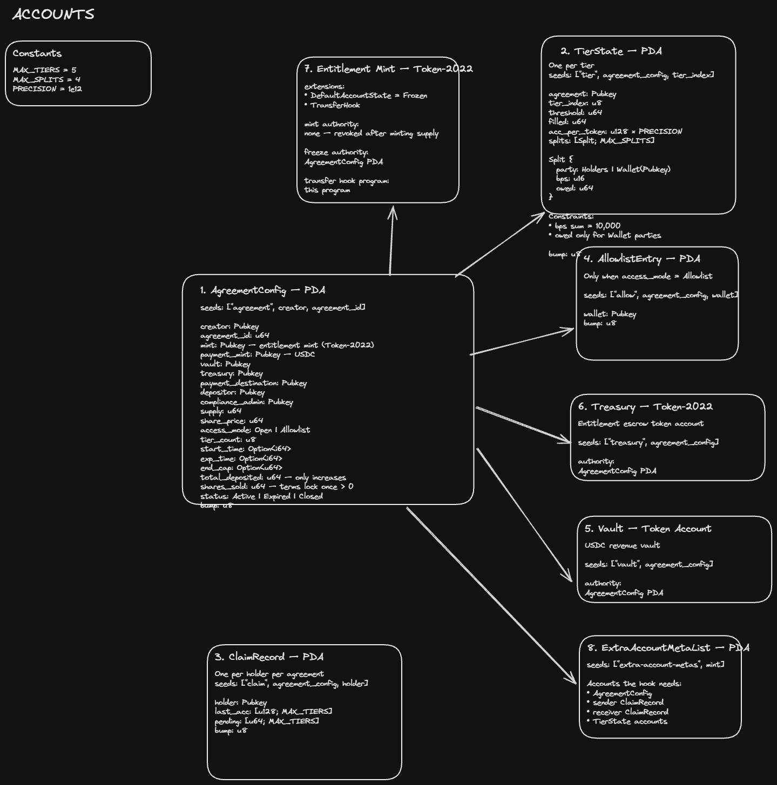
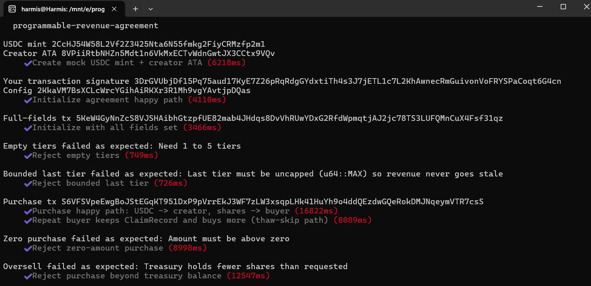
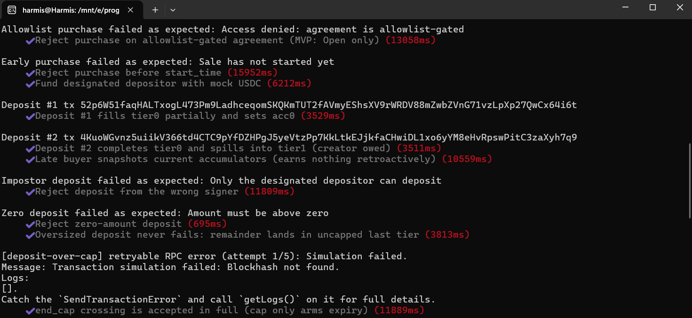
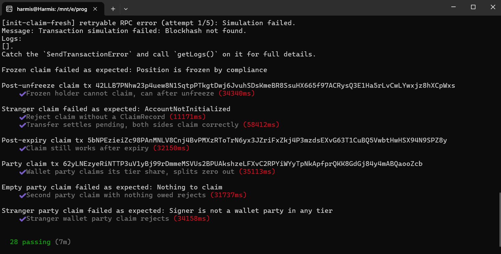

# Programmable Revenue Agreements

A decentralized protocol on Solana built with Anchor and Token-2022 that enables creators, protocols, and enterprises to tokenize future revenue streams into compliant, transferable entitlement tokens with deterministic on-chain waterfall distribution.

---

## Overview

Programmable Revenue Agreements (PRA) automate multi-party revenue splits, recoupment hurdles, and investor payouts directly on-chain:

1. **Agreement Creation**: A creator defines an agreement with fixed token supply, share price, waterfall tiers, and termination conditions. The protocol mints the entire fixed supply into a program-owned treasury with minting permanently disabled.
2. **Capital Formation**: Investors purchase entitlement tokens using USDC. Principal flows directly to the creator's payment destination—never co-mingling with revenue.
3. **Waterfall Revenue Ingestion**: A designated revenue depositor funds the program vault. The protocol fills tiers sequentially by cumulative deposit milestones and updates per-token earning accumulators in $O(1)$ constant time.
4. **Non-Dilutive Claims**: Token holders withdraw accrued earnings on demand. Payout calculations are strictly deterministic—claiming frequently or waiting until expiry yields the identical total.
5. **Transfer Hook Accounting**: A Token-2022 transfer hook snapshots accrued revenue into a pending claim record on every secondary transfer, ensuring historical earnings remain with the seller while the buyer only accrues future yield.
6. **Regulatory Compliance**: Accounts are frozen by default and thawed upon purchase. A designated Compliance Admin can freeze/thaw individual positions without custodial fund seizure.
7. **Lifecycle Expiry and Liquidation**: Once an expiration timestamp or cumulative revenue cap is reached, anyone can expire the agreement, burning all unsold treasury tokens. Following a defined claim window, the creator closes the agreement to reclaim remaining rent and unclaimed balances.

---

## Program Details

- **Program ID**: `2iEFwZ8qPjvEfSAtHqE7G7apQo9tVKFsiLrdAFC5sXop`
- **Network Deployment**: Localnet / Devnet
- **Framework**: Anchor 0.30.1 / Rust 1.75+
- **Entitlement Standard**: Token-2022 (`spl-token-2022`) with Default Account State (Frozen) and Transfer Hook
- **Payment / Revenue Standard**: SPL Token (USDC, 6 decimals)

---

## Architecture

### System Architecture Diagram



Detailed technical specifications and architectural design documents:
[Architecture Design Specification Document](https://docs.google.com/document/d/1y3AuhMfTQc6bgxOIPWIdEFQGnIeNWhCRh3dM10o-LWE/edit?usp=sharing)

---

## Value Pools and Actor Matrix

### Segregated Value Pools

- **Investor Capital**: Sent directly from buyer to creator's `payment_destination`. Never touches the vault.
- **Revenue Vault**: Program-controlled USDC account holding distributed revenue. Only claimable by entitled holders and designated tier parties.
- **Token Treasury**: Program-controlled token account holding unsold entitlement tokens. Completely burned upon expiry.

### Actor Roles

| Role | Responsibility |
| :--- | :--- |
| **Creator** | Initializes agreement, receives raise proceeds, closes agreement after claim window. |
| **Buyer / Holder** | Purchases entitlement tokens, transfers on secondary markets, claims accrued yield. |
| **Depositor** | Designated wallet authorized to deposit revenue into the vault. |
| **Compliance Admin** | Authorized authority capable of freezing or unfreezing specific holder positions (cannot be Creator). |
| **Public Caller** | Any network participant can invoke `expire_agreement` once end conditions are satisfied. |

---

## Core Mathematical Models

### 1. Cumulative Revenue Waterfall

Tiers fill sequentially based on total historical deposits. Each tier defines a cumulative milestone threshold and a set of basis-point splits (summing to 10,000 bps) allocated to either `Holders` or a designated `Wallet(pubkey)`. The final tier must be uncapped (`threshold = u64::MAX`) to guarantee deposits can never overflow.

### 2. $O(1)$ Scalable Accumulator

To prevent looping over token holders on deposit, each tier maintains a monotonically increasing accumulator (`acc_per_token` with $10^{12}$ precision factor):

$$\Delta \text{acc} = \frac{\text{take} \times \text{holders\_bps} \times 10^{12}}{10,000 \times \text{supply}}$$

Fixed wallet parties receive their share directly in state:

$$\Delta \text{owed} = \frac{\text{take} \times \text{wallet\_bps}}{10,000}$$

### 3. Claim Mechanics

A holder's claimable entitlement is calculated as:

$$\text{Claimable} = \frac{\text{balance} \times (\text{acc} - \text{last\_acc})}{10^{12}} + \text{pending}$$

Upon claim execution, `last_acc` is advanced to current `acc` and `pending` is reset to zero.

### 4. Transfer Hook Snapshotting

Token-2022 invokes the transfer hook after account balances are updated. The hook reconstructs pre-transfer balances:
- **Sender pre-balance**: $\text{current\_balance} + \text{amount}$
- **Receiver pre-balance**: $\text{current\_balance} - \text{amount}$

The hook computes accrued revenue for the sender up to that block, stores it in `pending`, and resets both parties' `last_acc` pointers to the current tier accumulator.

---

## Account Architecture & PDA Seeds

| Account | PDA Seeds | Description |
| :--- | :--- | :--- |
| `AgreementConfig` | `[b"agreement", creator, agreement_id.to_le_bytes()]` | Global agreement configuration, parameters, and status |
| `TierState` | `[b"tier", config, tier_index]` | Milestone threshold, filled amount, accumulator, and split rules |
| `ClaimRecord` | `[b"claim", config, holder]` | Per-holder sync state (`last_acc`, `pending`, `frozen` flag) |
| `Vault` | `[b"vault", config]` | Program-owned USDC token account for revenue distribution |
| `Treasury` | `[b"treasury", config]` | Program-owned Token-2022 account holding unsold supply |
| `ExtraAccountMetaList`| `[b"extra-account-metas", share_mint]` | Account metadata list resolving hook dependencies for Token-2022 |

---

## Instructions

### 1. `initialize_agreement`
Creates the agreement configuration, tier state accounts, Token-2022 share mint (with Default Account State: Frozen and Transfer Hook), treasury token account, and revenue vault. Mints the total supply to treasury and immediately revokes mint authority.

### 2. `purchase_share`
Atomically swaps buyer USDC for entitlement tokens from the treasury. Transfers payment directly to `payment_destination`, initializes/updates the buyer's `ClaimRecord`, and thaws the buyer's token account via config PDA.

### 3. `deposit_revenue`
Deposits USDC from the authorized depositor into the vault. Traverses tiers sequentially, allocating proceeds to tier accumulators and fixed wallet splits according to the waterfall.

### 4. `claim_tier_share`
Allows token holders to withdraw all accrued revenue across all active tiers. Computes claimable amount, updates accumulator cursors, zeroes pending amounts, and transfers USDC from vault to holder.

### 5. `claim_party_share`
Allows designated wallet beneficiaries (e.g. Creator recoupment splits) to claim their accumulated `owed` funds from tier state accounts.

### 6. `transfer_hook`
Executes during Token-2022 token transfers. Validates transfer authorization, settles accrued earnings for sender and receiver into `pending`, and resets tracking cursors.

### 7. `freeze_position` / `unfreeze_position`
Allows the Compliance Admin to freeze or unfreeze a specific holder's token account and set the `frozen` flag on their `ClaimRecord` to prevent claiming and transfers.

### 8. `expire_agreement`
Permissionless instruction callable once `now >= exp_time` or `total_deposited >= end_cap`. Sets agreement status to `Expired`, records the final `claim_deadline`, and burns all remaining unsold treasury tokens.

### 9. `close_agreement`
Callable by the Creator once all funds are claimed (`vault <= DUST_ALLOWANCE`) or the `claim_deadline` has passed. Transfers any remaining unclaimed vault funds to Creator, closes all state accounts, and reclaims rent lamports.

---

## Project Structure

```text
programmable-revenue-agreement/
├── Anchor.toml
├── Cargo.toml
├── package.json
├── protocol.md
├── programs/
│   └── programmable-revenue-agreement/
│       ├── Cargo.toml
│       ├── src/
│       │   ├── lib.rs
│       │   ├── constants.rs
│       │   ├── error.rs
│       │   ├── state.rs
│       │   ├── instructions.rs
│       │   └── instructions/
│       │       ├── initialize_agreement.rs
│       │       ├── purchase_share.rs
│       │       ├── deposit_revenue.rs
│       │       ├── claim_tier_share.rs
│       │       ├── claim_party_share.rs
│       │       ├── transfer_hook.rs
│       │       ├── freeze_position.rs
│       │       ├── unfreeze_position.rs
│       │       ├── expire_agreement.rs
│       │       └── close_agreement.rs
│       └── tests/
│           ├── reference_claim_vectors.rs
│           ├── freeze_unfreeze.rs
│           ├── expire_agreement.rs
│           └── close_agreement.rs
├── tests/
│   ├── helpers.ts
│   ├── main.ts
│   └── handlers/
│       ├── initialize-agreement.ts
│       ├── purchase-share.ts
│       ├── deposit-revenue.ts
│       └── claim-share.ts
├── docs/
│   ├── demo-kit.md
│   ├── requirement-traceability.md
│   └── typescript-tooling.md
└── asset/
    ├── arch_diagram.png
    ├── proof1.png
    ├── proof2.png
    └── proof3.png
```

---

## Building and Testing

### Prerequisites

- Rust `1.75.0+`
- Solana CLI `1.18+`
- Anchor CLI `0.30.1`
- Node.js `v18+` & Yarn

### Build

```bash
anchor build
```

### Run Tests

Execute the comprehensive test suites covering unit vectors, lifecycle phases, and transfer hook operations:

```bash
# TypeScript integration suite
yarn test

# Rust in-program integration tests
cargo test-sbf
```

---

## Execution & Test Proof

### 1. Agreement Initialization and Capital Raise Verification
Validation of agreement configuration, Token-2022 mint initialization with extensions, treasury funding, and direct USDC purchase flows:



---

### 2. Waterfall Deposits and Claim Settlement
Validation of cumulative deposit waterfalls across multiple tiers, precision accumulator updates, and non-dilutive holder claims:



---

### 3. Transfer Hook Accounting, Compliance, and Lifecycle Completion
Verification of Token-2022 transfer hook balance reconstruction, compliance freeze/thaw controls, agreement expiry, treasury burns, and post-window closing liquidation:

